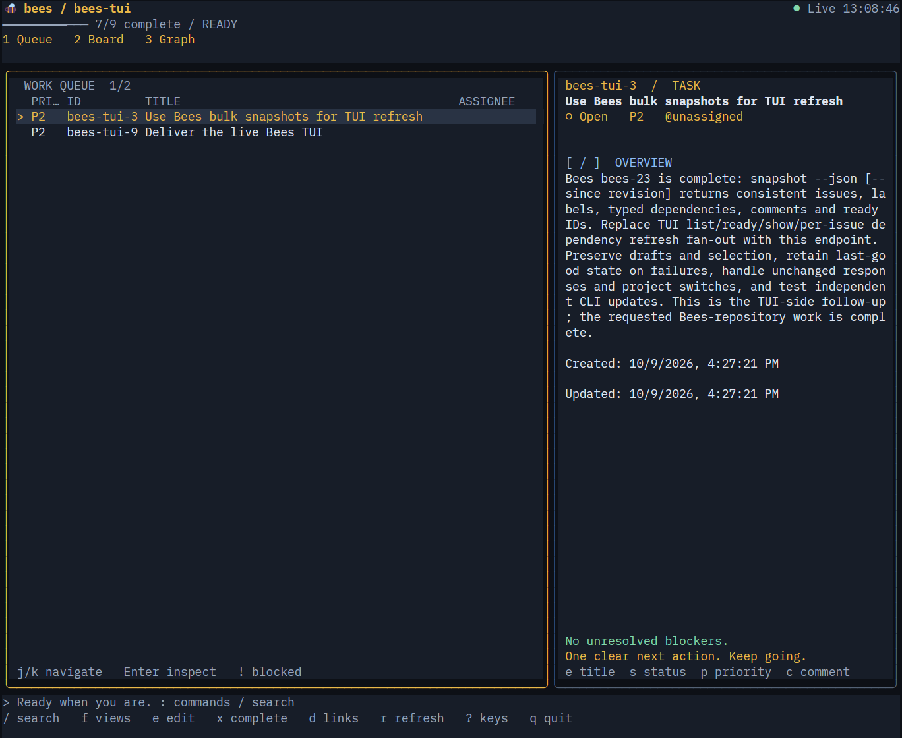
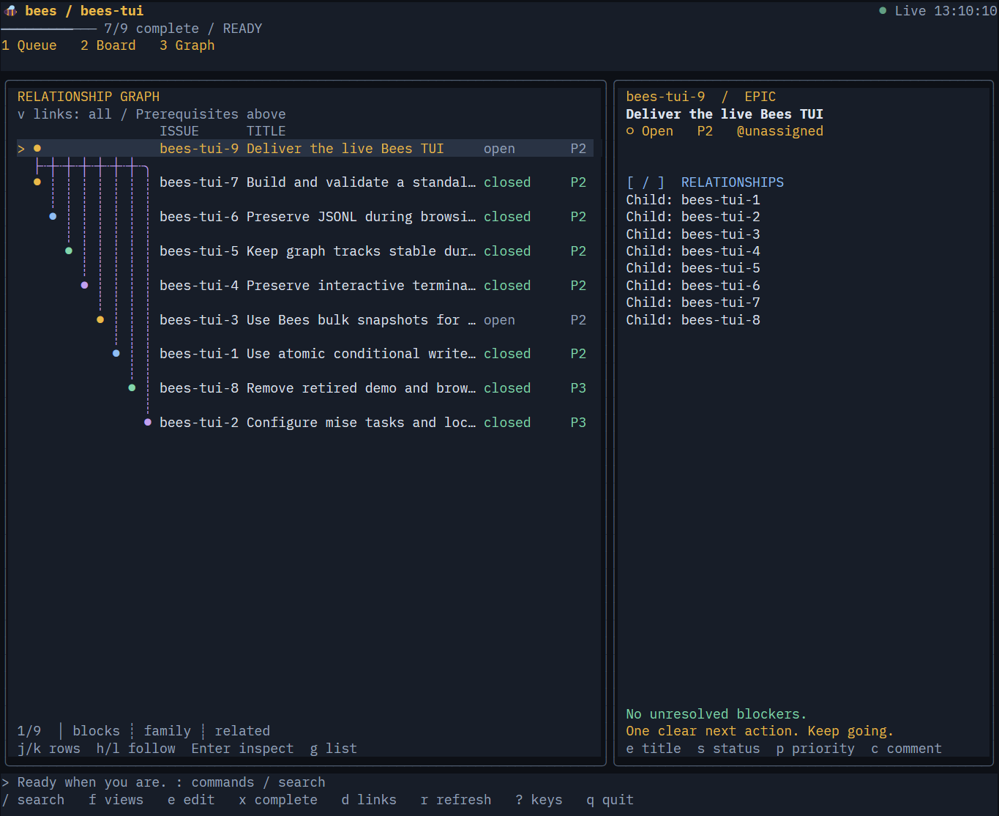

# 🐝 Bees TUI

A keyboard-first terminal app for Bees issues. Find ready work in **Queue**, move between statuses in **Board**, and follow dependencies in **Graph**.

Edit issues, labels and comments without leaving your terminal. Changes made by people or agents using the Bees CLI appear automatically. Browsing leaves `issues.jsonl` untouched.

| Queue | Graph |
| --- | --- |
| [](docs/queue.png) | [](docs/graph.png) |

*Click a screenshot to see it full size.*

## Get started

From this checkout, with mise installed:

```sh
mise install
mise run setup
mise run start
```

To open another Bees project:

```sh
mise run start -- -- --project /path/to/project
```

Use an interactive terminal. Press **1 / 2 / 3** to switch views, **:** for commands, **?** for help, and **q** to quit.

Without mise, use Node 22.12+ and a Bees executable on PATH:

```sh
npm ci
npm start -- --project /path/to/project
```

## Build a standalone app

With Bun installed, run `mise run build:binary`. On Windows, launch `release/bees-tui.exe`; users do not need Node, Bun or `node_modules`. The Bees CLI is still required. Git is optional for uncommitted-change markers.

Windows x64 is tested. Other platforms still need native terminal validation.

## Learn more

- [User guide](docs/USAGE.md) — views, keyboard controls, editing, live updates and preferences.
- [Development](docs/DEVELOPMENT.md) — setup, executable builds and tests.
- [Design](docs/DESIGN.md) — architecture and behavior contracts.
